<div align="center">

```
# Open-Source LLM Fine-Tuning with QLoRA 

### `> fine-tuning a 4B language model to reason over financial reports`


-00E5FF?style=flat-square&labelColor=0A0F24)

</div>

---

## `// 01` Overview

**FinQA** is a benchmark of numerical question answering over real financial reports: each question comes with narrative text, a financial table, and requires pulling out the right figures and computing an answer.

This project adapts **Qwen3-4B** to that task using **QLoRA**: the base model is frozen in 4-bit precision and only small low-rank adapters are trained. The result is a task-specialised model trained end to end on a single consumer-class GPU setup, with a reproducible four-script pipeline and a side-by-side evaluation against the untouched base model.

> **Headline result (preliminary, 20 test examples):** numeric answer accuracy rose from **21.1% → 47.4%** and normalized exact match from **0% → 45%** after fine-tuning. See [Results](#-04-results) for the caveats that matter.

---

## `// 02` Pipeline

```mermaid
flowchart LR
    A["bevaya/FinQA<br/>train · val · test"] --> B["_01_Preprocess.py<br/>clean + chat format"]
    B --> C["_02_Model.py<br/>4-bit NF4 + LoRA"]
    C --> D["_03_Train.py<br/>TRL SFTTrainer"]
    D --> E["results/qlora_adapter"]
    E --> F["_04_Evaluate.py<br/>base vs QLoRA"]
    F --> G["metrics.json<br/>model_comparison.csv"]

    style A fill:#0A0F24,stroke:#00E5FF,color:#00E5FF
    style B fill:#0A0F24,stroke:#00E5FF,color:#00E5FF
    style C fill:#0A0F24,stroke:#FFB000,color:#FFB000
    style D fill:#0A0F24,stroke:#FFB000,color:#FFB000
    style E fill:#0A0F24,stroke:#FF2BD6,color:#FF2BD6
    style F fill:#0A0F24,stroke:#00E5FF,color:#00E5FF
    style G fill:#0A0F24,stroke:#FF2BD6,color:#FF2BD6
```



| Stage | Script | What it does |
|:--:|:--|:--|
| **01** | [`_01_Preprocess.py`](_01_Preprocess.py) | Loads `bevaya/FinQA`, drops duplicate IDs and rows with missing question/answer, flattens tables into pipe-delimited text, and builds chat-style `prompt` / `completion` records saved to `data/processed/`. |
| **02** | [`_02_Model.py`](_02_Model.py) | Loads Qwen3-4B in 4-bit NF4 with double quantization, prepares it for k-bit training with gradient checkpointing, and attaches LoRA adapters. |
| **03** | [`_03_Train.py`](_03_Train.py) | Fine-tunes with TRL's `SFTTrainer` using completion-only loss, evaluates on the validation set, and keeps the best checkpoint. |
| **04** | [`_04_Evaluate.py`](_04_Evaluate.py) | Runs greedy decoding on the test set for both the base model and the adapter, scores both, and writes predictions and comparison files. |

---

## `// 03` Technical Details

### Data formatting

Each example becomes a chat conversation: a system message plus a user message containing the pre-table text, the table, the post-table text, and the question. The assistant turn is only the gold answer, and the loss is computed on that completion alone (`completion_only_loss=True`), so the model is never trained to reproduce the long financial context.

### Model and adapters

| Parameter | Value |
|:--|:--|
| Base model | `Qwen/Qwen3-4B` |
| Quantization | 4-bit NF4, double quantization, fp16 compute |
| LoRA rank / alpha / dropout | `16` / `32` / `0.05` |
| LoRA targets | `q_proj` `k_proj` `v_proj` `o_proj` `gate_proj` `up_proj` `down_proj` |
| Trainable weights | LoRA parameters only, cast to fp32 for stable fp16 training |

### Training configuration

| Parameter | Value |
|:--|:--|
| Epochs | 1 (771 optimizer steps) |
| Batch size | 1 per device × 8 gradient accumulation = effective 8 |
| Learning rate | `1e-4`, cosine schedule, 15 warmup steps |
| Gradient clipping | `0.3` |
| Max sequence length | 2048 tokens |
| Precision | fp16 mixed precision, gradient checkpointing |
| Checkpointing | Eval and save every 200 steps, best model by `eval_loss` kept |
| Seed | 42 |

A `SMOKE_TEST` flag in `_03_Train.py` runs a 3-step sanity check on a tiny subset before committing to a full run.

### Evaluation protocol

- **Decoding:** greedy (`do_sample=False`), up to 256 new tokens, Qwen3 thinking mode disabled.
- **Answer extraction:** strips any `<think>` block and special tokens, then takes the text after an "answer is / answer:" marker, or the last non-empty line.
- **Normalized exact match:** case, whitespace, currency symbols, and thousands separators are normalized, and numbers are canonicalized (so `1,200.0` matches `1200`).
- **Numeric answer accuracy:** the last number in the prediction is compared to the gold number with `rel_tol=1e-3` and `abs_tol=1e-3`. The percent-sign must match, so `14.1%` does not count as `14.1`.

---

## `// 04` Results

### Training

| Metric | Value |
|:--|--:|
| Train loss | `0.5384` |
| Validation loss | `0.3935` |
| Validation mean token accuracy | `0.8756` |
| Training time | 8 h 57 min |

### Base vs. QLoRA (preliminary, 20 randomly sampled test examples, seed 42)

| Metric | Base Qwen3-4B | QLoRA Qwen3-4B | Change |
|:--|:--:|:--:|:--:|
| Normalized exact match | 0 / 20 (**0.0%**) | 9 / 20 (**45.0%**) | **+45.0 pp** |
| Numeric answer accuracy | 4 / 19 (**21.1%**) | 9 / 19 (**47.4%**) | **+26.3 pp** |

```
NUMERIC ANSWER ACCURACY
base   ████░░░░░░░░░░░░░░░░  21.1%
qlora  █████████░░░░░░░░░░░  47.4%

NORMALIZED EXACT MATCH
base   ░░░░░░░░░░░░░░░░░░░░   0.0%
qlora  █████████░░░░░░░░░░░  45.0%
```

> [!IMPORTANT]
> **Read these numbers as a signal, not a verdict.** With only 20 examples, a single question changes accuracy by 5 points and the confidence intervals are very wide. Numeric accuracy is computed on the 19 examples the script identified as numeric. A full-test-set evaluation is the next step before drawing firm conclusions.

**Interpreting the gap.** FinQA gold answers are short and terse (for example a bare number or a percentage). The base model's 0% exact match is likely driven in part by output format, since it tends not to produce answers in that exact shape. The larger and more meaningful improvement is therefore the numeric accuracy gain, which is far less sensitive to formatting. Even there, fine-tuning more than doubled the number of correct answers (4 → 9).

---

## `// 05` Getting Started

### Requirements

- A CUDA-capable GPU (the scripts raise an error without one)
- Python 3.10+
- A recent version of TRL (the config uses `completion_only_loss`, `max_length`, and `eos_token` in `SFTConfig`)

```bash
pip install requirements.txt  # download requirements for project
```

### Run

```bash
python _01_Preprocess.py   # build data/processed/{train,validation,test}
python _03_Train.py        # imports _02_Model.py; saves adapter to results/qlora_adapter
python _04_Evaluate.py     # evaluates base and adapter; writes results/evaluation/
```

To evaluate on a subset, set `MAX_SAMPLES` at the top of `_04_Evaluate.py` (it samples randomly using `SEED`). Leave it as `None` to score the full test set.

---

## `// 06` Repository Structure

```
.
├── _01_Preprocess.py          # data cleaning + chat formatting
├── _02_Model.py               # 4-bit quantized model + LoRA config
├── _03_Train.py               # SFT training loop
├── _04_Evaluate.py            # base vs adapter evaluation
├── requirements.txt           # download requirements for project
├── data/processed/            # generated: train / validation / test
├── results/                   # generated: predictions + comparison files
    └── evaluation/
        ├── metrics.json       
        └── model_comparison.csv
    └── training/
        └── training_metrics.json            
```

---

## `// 07` Limitations

**Known limitations**

- Evaluation so far covers only 20 test examples and a single seed.
- The model answers directly, with Qwen3's thinking mode disabled, so multi-step arithmetic is done "in its head". This is a likely ceiling on accuracy for harder FinQA questions.
- Answer extraction takes the last number or last line, which can mis-score verbose outputs.
- The numeric tolerance (`1e-3` relative) is lenient for very large or very small values.
---

## `// 08` Acknowledgements

- [FinQA](https://github.com/czyssrs/FinQA) for the original benchmark, accessed here via the `bevaya/FinQA` dataset on Hugging Face
- [Qwen Team](https://huggingface.co/Qwen) for Qwen3
- Hugging Face `transformers`, `peft`, `trl`, and `datasets`, plus `bitsandbytes` for 4-bit quantization
- [QLoRA](https://arxiv.org/abs/2305.14314) (Dettmers et al., 2023)

---

## Author

**Alkiviadis Agrogiannhs**  
Data Scientist & Machine Learning Engineer 
[LinkedIn](https://www.linkedin.com/in/alkiviadis-agrogiannhs/)
[Email](mailto:alkiviadisagrogiannhs@gmail.com)
[GitHub](https://github.com/alkiviadisss)

---
